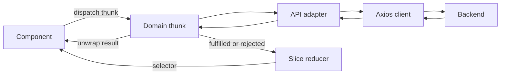

# Frontend architecture

The application has one backend-backed execution path. Network effects are implemented by Redux Toolkit async thunks; reducers are pure; components own presentation and temporary form state.

## Request flow

- `api/client.js` owns base URL, credentials, memory-only bearer tokens, a shared refresh promise, bounded 401 retry, and transport-error messages. It never imports a Redux store. The store registers a session-expiry callback.
- `api/backend.js` names endpoint operations and constructs HTTP payloads. No component constructs URLs or imports this module. Signed file links are used as returned by the backend.
- `api/models.js` maps backend fields to display/form fields: task completion/due dates, event instants, sender identities, folders and attachments. It does not perform requests.
- `redux/thunks` contains explicit domain operations. `createApiThunk` is a small common wrapper around `createAsyncThunk` for serializable errors and session-generation checks, not an action-intercepting middleware.
- `redux/slice` owns shared account/profile/preferences/workspace/mail metadata and request lifecycle state. `requestState.js` tracks independent pending/succeeded/failed states by thunk type and request ID.
- Mail/admin query results and selected message details are page-scoped. Form inputs, dialogs, selection and the draft-save queue are local React state. This avoids putting transient editor objects or files into global state.

## Authentication and account isolation

`SessionGate` dispatches `restoreSession` once through the thunk's condition. A missing refresh cookie leads to the login screen; network failures are displayed. Login and restore return only public user/folder/label data to Redux. Access tokens never appear in fulfilled action payloads or browser storage.

The root reducer resets every domain on confirmed logout or session expiry. It increments an in-memory generation number. A thunk started under an earlier generation cannot commit its response into the next account's state.

Roles use the backend's `admin/member` values. UI role checks hide unavailable controls; they do not replace server-side authorization. No local directory determines permissions.

## Async state and errors

Each tracked operation has `{status,error,requestId}` in its domain's `requests` map. Only the matching request can complete its lifecycle entry. Workspace lists also track the latest request per collection; a confirmed mutation invalidates an older list response so it cannot erase the change.

Components await `dispatch(thunk(args)).unwrap()`. Editors close and success messages appear only after confirmation. Rejected payloads contain `message`, HTTP `status`, and optional validation `details`. There is no synchronous fake-success reducer and no middleware translating old local mutations into HTTP calls.

The mail query effect debounces requests and aborts the previous thunk on cleanup. The AbortSignal reaches Axios. Autosave uses a per-composer promise queue: create/save, upload/remove, and send run in order against one server draft ID. A transport failure retains that ID and the editor; sending is not automatically retried after an ambiguous timeout.

## State boundaries

| Domain           | Shared state                                                                       | Temporary UI state                                                  |
| ---------------- | ---------------------------------------------------------------------------------- | ------------------------------------------------------------------- |
| Auth             | Public session, bootstrap/login state, generation                                  | Password inputs, reset form                                         |
| Profile/settings | Server-confirmed profile and normalized preferences                                | Unsaved edits, selected avatar file                                 |
| Mail             | Folders, labels, counts, server undo payload, invalidation revision, request state | Current page, selected detail, filters, selection, draft form/queue |
| Workspace        | Contacts/tasks/notes/events and list request IDs                                   | Search, selected calendar date, editor                              |
| Admin            | Request lifecycle state                                                            | Current query result, selected user/domain/alias editor             |
| UI               | Composer descriptor, notifications                                                 | Local menu/dialog state                                             |

Neither file bytes nor access/refresh tokens are stored in slices. DevTools is off in production and redacts password-bearing/file-upload action arguments in development.

## Extending the project

1. Confirm the endpoint exists and add the named adapter in `api/backend.js`.
2. Add a domain thunk. Return domain data rather than Axios response/config objects.
3. Add fulfilled handling to the slice when the result is shared. Use request IDs for overlapping reads.
4. Dispatch the thunk from the component and handle `.unwrap()` rejection without discarding unsaved input.
5. Test the request contract, successful state change, and a meaningful failure/race case.
6. Update the API inventory only when the backend's registered routes change.

ESLint prevents components/pages from importing `api/client` or `api/backend`. Prettier formats all source, tests and scripts. Browser tests catch runtime errors and Redux non-serializable-value errors.

## Deliberate limitations

This is a production-oriented frontend structure, not a claim that the deployed service has passed production acceptance. Real browser CORS/cookies, PostgreSQL behavior, external delivery, storage links and provider operations still require a reachable backend. Existing route limitations and missing server features are documented in [ENDPOINT_GAPS.md](ENDPOINT_GAPS.md). The UI remains a plain-text composer, and large workspace lists are subject to the backend's 1,000-record limit.
